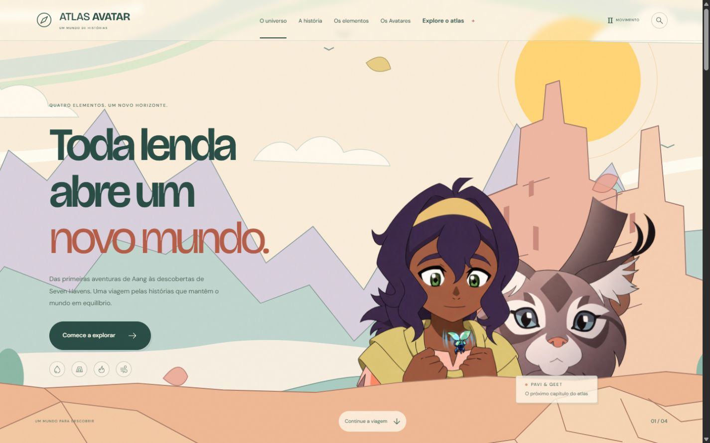
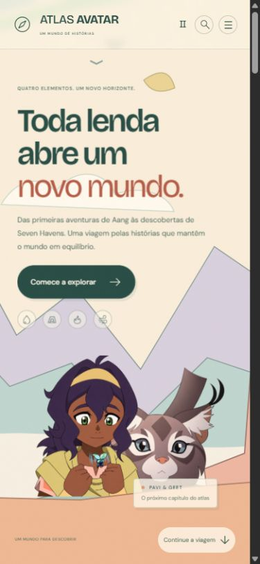

# Atlas Avatar

Um atlas interativo em português sobre o universo de Avatar. História, quatro elementos, Avatares, personagens, técnicas de dobra, criaturas e espíritos em uma experiência visual clara e colorida.

**[Explorar o site publicado →](https://atlas-avatar.vercel.app/)**



<details>
<summary>Ver a versão mobile</summary>



</details>

## A ideia por trás do projeto

Quando comecei a estudar programação, tentei criar um site com a temática de Avatar. O resultado foi simples e o projeto não foi adiante. Este atlas retoma aquela ideia como um marco da minha evolução no desenvolvimento web: uma experiência com identidade visual, conteúdo organizado, interações e adaptação para diferentes telas.

## O que explorar

- **14 páginas** conectadas: início, história, Água, Terra, Fogo, Ar, Avatares, Aang, Korra, Seven Havens, personagens, dobras, criaturas e fontes.
- **Cenários geométricos em camadas**, recortes transparentes e parallax de rolagem.
- **Cartas animadas** que revelam a identidade de cada elemento.
- **Busca geral** por personagens, elementos, técnicas, criaturas e livros.
- **48 personagens**, com filtros combinados por habilidade e era e busca por nome ou habilidade.
- **19 técnicas e aplicações**, com usuários, limites e referências.
- **14 fichas de criaturas e espíritos** e **8 Avatares**, com retratos e fontes.
- **Navegação responsiva**, menu mobile, foco visível, link para pular o menu, rótulos acessíveis e contadores de resultados.
- **Controle de movimento** e respeito à preferência por animações reduzidas.

## Tecnologias

HTML, CSS, JavaScript e SVG. O site usa arquivos estáticos, sem dependências de execução ou etapa de compilação. Os dados do atlas ficam separados das funções de apresentação e das interações.

## Executar localmente

Requer Node.js 20 ou superior.

```sh
npm run dev
```

Abra **http://127.0.0.1:4173**. Para verificar referências locais, imagens, fontes e identificadores:

```sh
npm run check
```

## Estrutura

```text
dist/                  Páginas, estilos, dados, interações e imagens
  app.js               Composição das páginas, navegação e busca geral
  atlas-pages.js       Catálogos e filtros
  data.js              Dados das séries, elementos e referências
  atlas-data.js        Personagens, técnicas e criaturas
  painted-motion.js    Parallax e preferências de movimento
  assets/              Ilustrações, retratos e registros de origem
scripts/check-site.mjs Verificação da integridade do conteúdo local
serve.mjs              Servidor local
vercel.json            Publicação estática da pasta dist
```

## Publicação

Na Vercel, importe o repositório como **Other**, mantenha a raiz do projeto e use **dist** como diretório de saída. Não é necessário instalar dependências ou executar um build. Essas opções já estão em `vercel.json`.

## Créditos e uso de recursos

Projeto de fãs independente, sem vínculo com Nickelodeon ou Paramount. Avatar, personagens, imagens oficiais e materiais de divulgação pertencem aos respectivos titulares. Os cenários geométricos são ilustrações decorativas do atlas; não são localidades canônicas.

Retratos complementares foram consultados na Avatar Wiki/Fandom, com origem registrada nas fichas e nos arquivos `dist/assets/image-sources.json` e `dist/assets/credits.json`. Os recortes transparentes foram adaptados a partir de artes oficiais com assistência de IA para a composição. A página **Fontes e créditos** detalha as referências visuais e de conteúdo. O desenvolvimento deste projeto contou com assistência de IA.

Informações editoriais consultadas em 16 de outubro de 2026. Disponibilidade de séries e anúncios pode variar conforme região e data.
